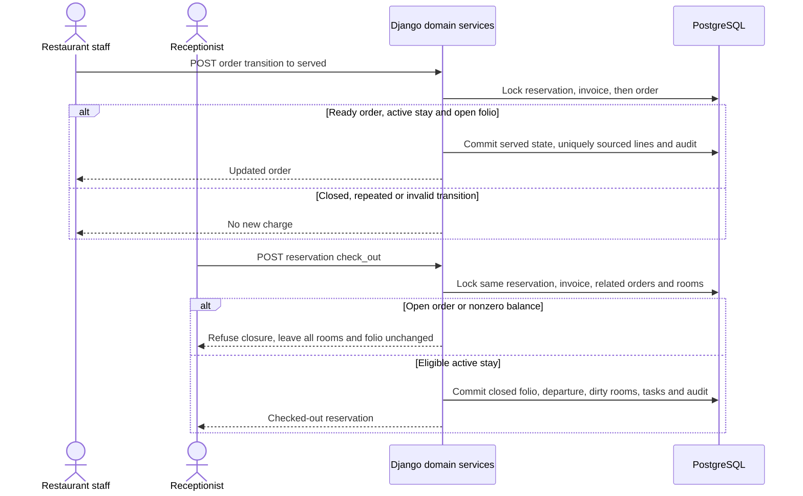

# System design — Hotel A staff application

**Objective:** promise a room only once for a night, admit a guest only when *every* booked room is ready, and close a stay only against what was actually charged and received. This is the engineering design for the authorized build, not a description of Hotel A's existing procedures, proof of deployment, or an academic chapter. The [SRS](../requirements/srs.md) defines acceptance; the [build contract](build_contract.md) fixes the API, domain names and software defaults. It supersedes the [discovery report's](../discovery_report.md) illustrative endpoints and candidate entities.

## Read the diagrams

| Mermaid source | Question it answers |
|---|---|
| [System context](../diagrams/system_context.mmd) | Who uses the application? Where are guest communication and tender verification outside its boundary? |
| [System architecture](../diagrams/system_architecture.mmd) | Where are access checks, domain calls, the shared DB transaction and private images? |
| [Use cases](../diagrams/use_case.mmd) | Which staff roles perform representative FR-01–10 tasks? The full grants are in the SRS, not inferred from these edges. |
| [Process flows](../diagrams/process_flows.mmd) | How do search, commitment, admission, service, settlement and turnover fit together? |
| [Activity diagrams](../diagrams/activity_diagrams.mmd) | At what decisions do assignment, a repair block or a parking allocation stop? |
| [Physical ERD](../diagrams/erd.mmd) and [data dictionary](database_design.md) | Which relations, keys, constraints, indexes and migration dependencies implement the rules? |

## Components and interface

Each staff browser talks to one origin. The web entry point serves the built React/TypeScript client and routes `/api/v1/` to a **modular Django/DRF monolith**. Vite can proxy API calls during development. One PostgreSQL database allows a stay change, its dependent writes and its history to commit together. Splitting billing and lodging into separately committed services would permit a closed stay with an open folio. Guests do not log in; no payment processor is connected.

| Screen / requirement | Owning package | API resources (relative to `/api/v1/`) |
|---|---|---|
| Overview `/` and inbox `/notifications` · FR-01 | `apps.core` reads authorized operational records | `dashboard/`, `notifications/`, `notifications/{id}/read/` |
| Guests `/guests` · FR-02 | `apps.lodging` | `guests/`, `guests/{id}/history/` |
| Reservations `/reservations` · FR-03 | `apps.lodging` coordinates stays | `reservations/`, `reservations/{id}/{confirm,cancel,check_in,check_out}/` |
| Rooms `/rooms` · FR-04 | `apps.lodging` owns catalog and claim calendar | `rooms/`, `rooms/availability/?arrival=…&departure=…` |
| Housekeeping & repairs `/housekeeping` · FR-05 | `apps.housekeeping` | `cleaning-tasks/`, `cleaning-tasks/{id}/transition/`, `maintenance/`, `maintenance/{id}/resolve/` |
| Restaurant `/restaurant` · FR-06 | `apps.restaurant` | `menu-items/`, `orders/`, `orders/stays/`, `orders/{id}/transition/` |
| Billing `/billing` · FR-07 | `apps.billing` | `invoices/`, `invoices/{id}/`, `invoices/{id}/{charges,payments}/`, `payments/`, `payments/{id}/` |
| Parking `/parking` · FR-08 | `apps.parking` | `parking-spaces/`, `vehicles/`, `parking-allocations/`, `parking-allocations/{id}/release/` |
| Staff & activity `/staff` · FR-09 | `apps.core` | `staff/`, `staff/{id}/`, `staff/assignees/?role=…`, `audit/` |
| Login `/login`, recovery `/reset` and `/reset/:uid/:token` · FR-10 | `apps.core`, Django auth | `auth/me/`, `auth/login/`, `auth/logout/`, `auth/reset/`, `auth/reset/confirm/` |

**Request boundary.** The client prefixes the API path once. Use GET for reads, POST for creation/actions and PATCH for allowed edits; no routine DELETE. Collections use `{count,next,previous,results}`, default 25, maximum `page_size` 100, with bounded search/status filters where supported. Foreign keys are numeric IDs; staff ID means `User.id`, not the profile row ID. Money is a two-decimal string. A serializer validates the inputs; a command checks its transition under lock. Supplying a total, receiver or arbitrary status is not a substitute for a command. `400` indicates invalid input, `409` a conflict with committed state. Denied actions and missing/out-of-scope objects yield no protected data (`403` or `404` as applicable).

**Interface design.** The shell reads capabilities before showing workspaces. Front desk uses a guest/room picker, arrival/departure dates, a multi-room selection and a reservation history; a successful search does not disable the conflict path. Facilities staff see assigned queues; managers see dispatch/inspection. Restaurant work uses an active-stay picker returning only the booking ID and booked room IDs/numbers. Finance displays lines, receipts and balance separately; the read-only folio view has no tender action. Use labeled fields, text status, visible keyboard focus, paginated lists and a phone-width task view. Preserve entered data on validation/conflict and refresh authoritative state after success. Loading, no permitted data, successful empty results and request failure are distinct; never substitute fixture counts. No reference artwork is assumed or reproduced.

## Data model and workflow rules

Domain records have generated integer IDs (`BigAutoField`), foreign keys to their actual owners, KES `Decimal(12,2)`, aware event timestamps and Nairobi-local booking **dates**. Current room/menu prices belong to catalogs; an agreed rate on a room claim or an accepted price on an order line is a different historical fact. Keep guest identity, reservations, dated room claims, order/charge lines, tender events and parking assignments separate rather than copying mutable labels or totals into each. The [physical design](database_design.md) explains normalization exceptions and database constraints.

| Question | Authoritative rule |
|---|---|
| Can we sell the requested nights? | `Room.is_active` and no overlapping **blocking** `RoomClaim` for that room in `[arrival, departure)`. Exactly one claim source: reservation **or** maintenance. Pending claims do not block. The `btree_gist` exclusion is on the claim, not a reservation status in a different table. |
| Can the guest enter now? | A confirmed booking eligible for the local date, with every booked room active, actually vacant, inspected and not under an applicable blocking repair. Occupancy comes from the room's reservation being `checked_in`, *not* from the calendar; an overdue guest can still occupy the room. Planned dates and actual arrival/departure timestamps are separate facts on `Reservation`, not a second Stay table. |
| Is the room clean? | `Room.cleanliness` is `dirty` or `inspected`. Task path: `pending → assigned → in_progress → completed → inspected`. Completing work does not inspect it. Managers dispatch/inspect; the room catalog cannot bypass this workflow. A repair is `open` or `resolved`; resolving one block does not clear another cause of unavailability. |
| What is owed? | `total = Σ(quantity × unit_price)` from invoice lines; `paid = Σ(amount)` from payments on that invoice; `balance = total − paid`. Sum each child set separately: directly joining several lines to several payments multiplies the results. Receipt number derives from the immutable payment ID; no editable paid flag or separate receipt ledger. |

### Commands that must not split across requests

Each successful business change records its non-sensitive audit event in the same transaction. On failure, a fresh read sees the pre-command state. Where their locks are needed, acquire **reservation → invoice → existing orders → physical rooms**, sorting IDs within each set. New child rows are protected by locking their owner; a query that finds no conflicting rows is not a lock on future inserts.

1. **Commit or amend rooms** (QA-02–04, QA-08). `POST reservations/` takes `guest`, `arrival`, `departure`, `room_ids` and optional `confirm:false`; otherwise create confirmed. Confirmation or pre-arrival amendment locks the booking and all old/new rooms in stable order, checks dates and claims again, then saves all rooms, agreed rates, state and event together. Cancellation before admission releases eligible claims but retains history. A blocking repair locks the same room and commits its request and claim together; a conflict never silently displaces a guest.
2. **Admit and open the folio** (QA-08, QA-13, QA-17). Check every room under lock. Only then record `checked_in` and its instant; `billing.services.open_folio` posts each room's agreed rate × booked nights to the one reservation invoice. Roll back occupancy and lines if any room or posting fails.
3. **Take and serve an order** (QA-09, QA-11, QA-14, QA-19). Require available menu items, positive quantities and a valid active assignee if selected. Room service binds to the checked-in reservation; for a multi-room booking the selected room must be one of its rooms. Dine-in uses no fictitious stay. `pending → confirmed → preparing → ready → served` is the service path; permitted pre-service cancellation ends at `cancelled`. A pending order is not billable. Serving calls `billing.services.post_order` with unique line sources; meal and charge succeed together. Dine-in posts to a standalone invoice; restaurant staff never record a tender.
4. **Add a charge or record receipt of funds** (QA-07, QA-19). Only an authorized billing operator can add a referenced extra service or submit `{amount,method,reference}` for money already received/confirmed **outside** the app. Lock the invoice, check stable reference and open balance, reject a new payment unless `0 < amount ≤ balance`. Identical authorized retries return the original payment/receipt; contradictory reuse must not create a record or reveal someone else's invoice. A checkout click, order status or client callback cannot create money.
5. **Close the whole stay** (QA-09, QA-13–14). Under the same reservation lock as order creation and serving, call `restaurant.services.assert_no_open_orders` (only served/cancelled are final) and `billing.services.close_folio` (requires zero balance). Record actual departure, release only unused nights and call `housekeeping.services.turnover(room,user)` once for each booked room: dirty plus pending task. Do not shorten contracted dates, revise agreed charges or infer a refund on early departure. A repeated/refused checkout cannot add more turnover tasks.
6. **Assign work or parking** (QA-10, QA-12, QA-15). Recheck active staff and role when saving, not just when populating the assignee picker. Restrict worker updates to assigned tasks/repairs. In parking, a vehicle belongs to a guest; lock the active space and vehicle, then enforce two independent unique active-allocation rules (`ended_at IS NULL`). Release timestamps the allocation, rather than deleting it.

**Sequence: why checkout and room service share a lock** (QA-09/14). The diagram shows the checks inside two independent commands, not an automatic checkout after serving.

If checkout acquires the stay lock first, a later room order must re-read the stay and reject a closed booking. It must never find a new occupant by room number and transfer the charge.

## Dashboard, access and operations

**Reporting (FR-01/07).** The [dashboard selector](../../backend/apps/core/dashboard.py) scopes each metric and worklist before returning it. Omit keys outside the caller's grants. Notifications and read markers belong to the recipient. Counts use the Nairobi day; the tiles are not parts of one total.

| Metric | What it counts |
|---|---|
| `check_ins`, `check_outs` | **Scheduled bookings** whose arrival/departure date is today, excluding pending and cancelled; a two-room stay counts once. Label these “Scheduled today,” not “Recorded today.” Actual movement is evidenced by `checked_in_at`/`checked_out_at`. |
| `available_rooms`, `occupied_rooms` | Active rooms neither occupied nor under a blocking claim tonight; separately, distinct rooms of checked-in reservations. Available tonight does not mean inspected for immediate entry. |
| `reserved_rooms`, `cleaning_rooms` | Distinct rooms under a confirmed booking claim tonight; separately, rooms whose cleanliness is dirty. Count rooms, not tasks. |
| `total_guests` | Registered guest profiles, not occupants or arrivals. |
| `billed`, `collected` | For `[local midnight, next local midnight)`, sum `quantity × unit_price` by indexed **`InvoiceItem.created_at`** and sum `Payment.amount` by **`Payment.created_at`**, respectively. The summary requires `billing.manage`. Never date later extras by invoice creation or count a restaurant order twice. |

**Security (FR-09/10).** `GET auth/me/` sets the CSRF cookie and returns the current user's roles/capabilities or `user:null`. Use server-side Django sessions, CSRF on unsafe methods including login, POST logout, expiry and generic password-reset responses. Deliver reset tokens only through the configured recovery channel; do not log them. `SecureViewSet` denies undeclared actions; `can` checks active user and Django permissions. Scope querysets, nested fields, creation inputs, transitions, aggregates and media as well as detail views. A department label or hidden button grants nothing. Re-encode bounded raster room/menu uploads via `SafeImageField`; store privately and serve only after checking the relevant grant. Audit actor, action, object and a non-sensitive summary; keep guest contact, plates, tender details, credentials and research material out of shared logs.

**Deployment and verification.** Serve UI/API over one HTTPS origin; keep DB, durable media and secrets off public routes. Configure secure cookies, allowed origins/hosts, mail and extension privileges for the target. Monitor API errors, failed mail delivery, DB contention and backup completion without logging request bodies. Verify migrations against empty PostgreSQL, exercise two independent transactions for competing bookings/orders/tenders/parking, then check final rows on a fresh connection. Run scoped API tests and a keyboard/phone browser walk-through against real API responses. Restore **both database and media** in isolation; reconcile claims, invoices, receipts and protected image reads before any live handover. The SRS cases and these gates are verification plans, not measured performance, restore results or live sign-off.

**Engineering references:** [Django: PostgreSQL exclusion constraints](https://docs.djangoproject.com/en/5.2/ref/contrib/postgres/constraints/), [PostgreSQL: range bounds and exclusion](https://www.postgresql.org/docs/current/rangetypes.html), [DRF: limits of object permissions on lists and creates](https://www.django-rest-framework.org/api-guide/permissions/#limitations-of-object-level-permissions). These support technical mechanisms, not claims about Hotel A.
